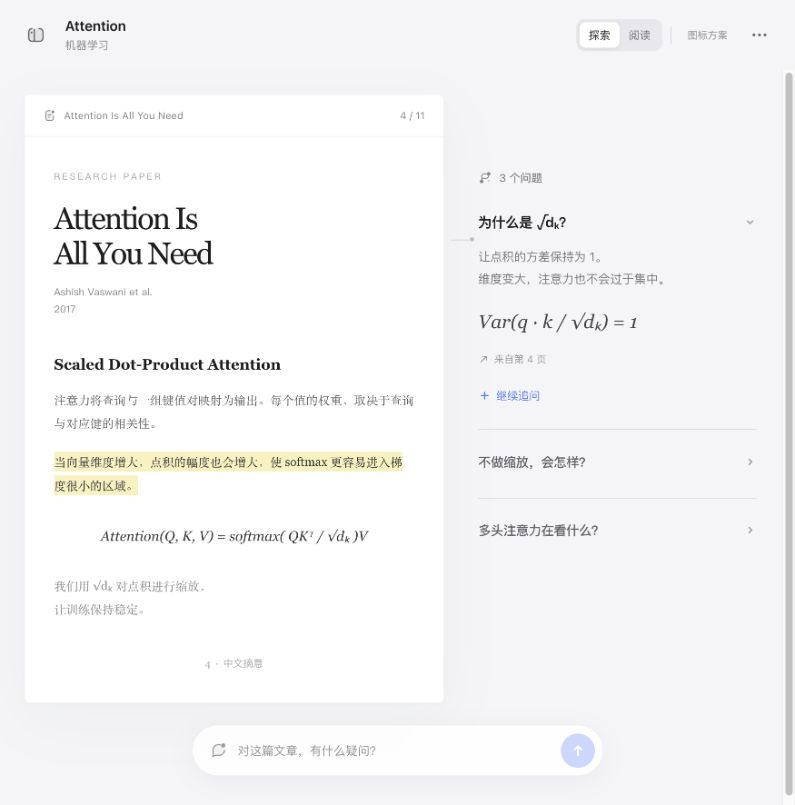

# Q Graph · Calm UI

阅读优先的简洁界面，以及「连点」SVG 图标语言。

让文档成为视觉中心，用按需展开的问题、简短文案和克制的工具栏组织工作空间。实心节点、柔和弧线与少量浅填充组成统一的图标语言。



## 内容

- **交互样机**：原文阅读、问题展开、阅读／探索切换、侧栏和演示提问。
- **10 个 SVG**：项目、资料、关联、提问、资料库、添加、发送、展开、来源和更多操作。
- **设计规则**：布局、字体、颜色、控件、文案与图标扩展方法。
- **Codex skill**：可复用的 `qgraph-calm-ui` 技能及完整参考素材。

## 本地预览

无需安装前端依赖。在仓库目录运行：

```sh
python3 -m http.server 8791 --bind 127.0.0.1 --directory assets/reference
```

打开 <http://127.0.0.1:8791>。也可直接用浏览器打开 `assets/reference/index.html`。

这是设计样机，使用示例论文内容，不包含 Q Graph 后端或数据库，不调用真实 AI。新问题只保留在当前页面，刷新后重置。页码与来源为示例展示，不是可操作的 PDF 阅读器。

## 安装 skill

将本仓库克隆到个人 skills 目录中一个尚不存在的目录：

```sh
git clone https://github.com/THEzsc/qgraph-calm-ui.git ~/.codex/skills/qgraph-calm-ui
```

如果该目录已存在，请先检查已有版本，避免覆盖本地修改。使用自定义 Codex 配置目录时，将目标调整为其 `skills/qgraph-calm-ui`。

调用示例：

> 使用 $qgraph-calm-ui 优化这个页面，保留现有功能，采用阅读优先布局和连点图标语言。

## 文件

| 路径 | 用途 |
| --- | --- |
| `SKILL.md` | 技能入口 |
| `references/interface.md` | 界面与文案规则 |
| `references/icons.md` | 图标语言与扩展规范 |
| `assets/icons/` | 10 个独立 SVG，使用 `currentColor` |
| `assets/reference/` | 无外部依赖的 HTML / JS 样机 |
| `assets/approved-preview.jpg` | 设计参考截图 |

图标模块中的 DOM 替换方法面向静态样机。集成到 React 等框架时，应转换为对应组件，避免直接修改框架管理的 DOM。

## 设计边界

这是一套独立的界面研究，不是 Apple 官方设计资源，也不包含 SF Symbols。浅色样机不代表已经完成完整的暗色、高对比度及无障碍系统；实际集成时需结合内容与设备验证。

示例内容参考 Vaswani 等人的 [Attention Is All You Need](https://arxiv.org/abs/1706.03762)，中文段落为概念摘意，非论文完整复制。
